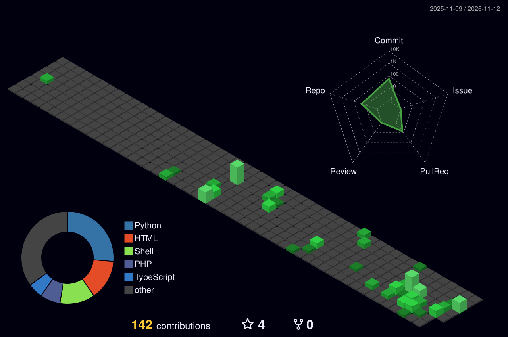

<!-- ═══════════════════════════════════════════════════════════════════════
     ⚡ PRITOM SIDDIQUE (PRITOMX) — ULTIMATE MASTER PROFILE README ⚡
     50 Ideas · 10 × 5🔥 Effects · Full Bio · Live Support · All SVGs
     ═══════════════════════════════════════════════════════════════════════ -->

<!-- 🌊 [IDEA 3] ANIMATED WAVE BANNER -->
<div align="center">
  
</div>

<!-- 👋 [IDEA 2] WAVING HAND + NAME -->
<h1 align="center">
  
  Hi, I'm <strong>Pritom Siddique</strong> (PritomX)
  
</h1>

<!-- ⚡ [IDEA 2/20] ANIMATED GRADIENT STROKE LOGO -->
<div align="center">
  <svg width="500" height="100" viewBox="0 0 500 100">
    <defs>
      <linearGradient id="masterLogoGrad" x1="0%" y1="0%" x2="100%" y2="0%">
        <stop offset="0%" stop-color="#00FF00">
          <animate attributeName="stop-color" values="#00FF00;#00FFFF;#FF00FF;#FFD700;#00FF00" dur="4s" repeatCount="indefinite"/>
        </stop>
        <stop offset="100%" stop-color="#00FFFF">
          <animate attributeName="stop-color" values="#00FFFF;#FF00FF;#FFD700;#00FF00;#00FFFF" dur="4s" repeatCount="indefinite"/>
        </stop>
      </linearGradient>
    </defs>
    <text x="250" y="60" text-anchor="middle" font-family="Fira Code, monospace" 
          font-size="42" font-weight="900" fill="none" stroke="url(#masterLogoGrad)" stroke-width="2"
          stroke-dasharray="800" stroke-dashoffset="800" letter-spacing="4">
      ⚡ PRITOMX ⚡
      <animate attributeName="stroke-dashoffset" from="800" to="0" dur="3s" fill="freeze"/>
      <animate attributeName="fill" from="none" to="#00FF00" dur="1s" begin="3s" fill="freeze"/>
    </text>
    <text x="250" y="85" text-anchor="middle" font-family="Fira Code, monospace" 
          font-size="11" fill="#8b949e" letter-spacing="3">CYBER FULL STACK DEVELOPER</text>
  </svg>
</div>

<br/>

<!-- ⌨️ [IDEA 1/14] MULTI-LAYER ROTATION TYPEWRITER -->
<div align="center">
  
  <br/>
  
</div>

<br/>

<!-- 🟢 [IDEA 4/9] CURSOR BLINK TERMINAL -->
<div align="center">
  
</div>

<br/>

<!-- 🌈 [IDEA 12] RAINBOW GRADIENT TYPEWRITER -->
<div align="center">
  
</div>

<br/>

<!-- 🎨 [IDEA 5] HOLOGRAPHIC SHIMMER BADGE -->
<div align="center">
  <svg xmlns="http://www.w3.org/2000/svg" width="420" height="50" viewBox="0 0 420 50">
    <defs>
      <linearGradient id="masterHolo" x1="0%" y1="0%" x2="100%" y2="0%">
        <stop offset="0%" stop-color="#FF00FF"><animate attributeName="offset" values="-1;1;2" dur="3s" repeatCount="indefinite"/></stop>
        <stop offset="50%" stop-color="#00FFFF"><animate attributeName="offset" values="-0.5;1.5;2.5" dur="3s" repeatCount="indefinite"/></stop>
        <stop offset="100%" stop-color="#FFD700"><animate attributeName="offset" values="0;2;3" dur="3s" repeatCount="indefinite"/></stop>
      </linearGradient>
    </defs>
    <rect x="0" y="0" width="420" height="50" rx="25" fill="url(#masterHolo)"/>
    <text x="210" y="32" text-anchor="middle" fill="#000" font-family="Fira Code, monospace" font-weight="900" font-size="16">
      ✨ PRITOMX · CYBER DEVELOPER · TOP RATED ✨
    </text>
  </svg>
</div>

<br/>

<!-- 🔗 SOCIAL BADGES — ALL PLATFORMS -->
<div align="center">

<a href="https://github.com/pritomit">
  
</a>
<a href="http://pritomsiddique7.free.nf">
  
</a>
<a href="https://www.linkedin.com/in/pritom-siddique-308623294">
  
</a>
<a href="https://wa.me/8801410174077">
  
</a>
<a href="https://m.me/pritom.it">
  
</a>
<a href="mailto:pritomsiddique@gmail.com">
  
</a>
<a href="https://www.facebook.com/pritomit">
  
</a>
<a href="https://pritomsiddique.blogspot.com">
  
</a>
<a href="https://dev.to/pritomit">
  
</a>
<a href="https://codepen.io/Pritom-Siddique">
  
</a>
<a href="https://bughunters.google.com/profile/c7673af4-977d-4b4a-9ad3-1433aba9f050">
  
</a>

</div>

<br/>

<!-- 🔥 [IDEA 1/20] NEON GLOW SVG ICONS -->
<div align="center">
  <a href="https://github.com/pritomit">
    <svg width="50" height="50" viewBox="0 0 24 24" xmlns="http://www.w3.org/2000/svg">
      <defs>
        <filter id="masterNeonGlow">
          <feGaussianBlur stdDeviation="2.5" result="coloredBlur"/>
          <feMerge>
            <feMergeNode in="coloredBlur"/>
            <feMergeNode in="SourceGraphic"/>
          </feMerge>
        </filter>
      </defs>
      <path fill="#00FF00" filter="url(#masterNeonGlow)" d="M12 0C5.37 0 0 5.37 0 12c0 5.3 3.44 9.8 8.21 11.39.6.11.82-.26.82-.58 0-.29-.01-1.04-.02-2.05-3.34.72-4.04-1.61-4.04-1.61-.55-1.39-1.34-1.76-1.34-1.76-1.09-.75.08-.73.08-.73 1.2.08 1.84 1.24 1.84 1.24 1.08 1.84 2.83 1.31 3.52 1 .11-.78.42-1.31.76-1.61-2.67-.3-5.47-1.33-5.47-5.93 0-1.31.47-2.38 1.24-3.22-.12-.3-.54-1.52.12-3.18 0 0 1.01-.32 3.3 1.23a11.5 11.5 0 0 1 6 0c2.29-1.55 3.3-1.23 3.3-1.23.66 1.66.24 2.88.12 3.18.77.84 1.24 1.91 1.24 3.22 0 4.61-2.81 5.63-5.48 5.92.43.37.81 1.1.81 2.22 0 1.6-.01 2.89-.01 3.28 0 .32.21.7.82.58C20.56 21.8 24 17.3 24 12c0-6.63-5.37-12-12-12z"/>
    </svg>
  </a>
  &nbsp;
  <a href="https://www.linkedin.com/in/pritom-siddique-308623294">
    <svg width="50" height="50" viewBox="0 0 24 24">
      <defs>
        <filter id="masterNeonBlue"><feGaussianBlur stdDeviation="2.5" result="blur"/><feMerge><feMergeNode in="blur"/><feMergeNode in="SourceGraphic"/></feMerge></filter>
      </defs>
      <path fill="#00B2FF" filter="url(#masterNeonBlue)" d="M20.45 20.45h-3.55v-5.57c0-1.33-.02-3.04-1.85-3.04-1.85 0-2.13 1.45-2.13 2.94v5.67H9.36V9h3.41v1.56h.05c.48-.9 1.64-1.85 3.37-1.85 3.6 0 4.27 2.37 4.27 5.45v6.29zM5.34 7.43a2.06 2.06 0 1 1 0-4.12 2.06 2.06 0 0 1 0 4.12zM7.12 20.45H3.56V9h3.56v11.45z"/>
    </svg>
  </a>
</div>

<br/>

<!-- 🌧️ [IDEA 17] MATRIX RAIN BG STRIP -->
<div align="center">
  
</div>

---

## 🎯 About Me

<table>
<tr>
<td width="60%">

```yaml
┌──────────────────────────────────────────────────┐
│  PRITOM SIDDIQUE (PRITOMX)                       │
│  ────────────────────────────────────────────    │
│  Cyber Full Stack Developer                      │
│  Digital Marketing Specialist                    │
│  TryHackMe Certified · Google Certified          │
│  Upwork Top Rated · 96% Job Success              │
└──────────────────────────────────────────────────┘
```

**📍 Location:** Chittagong, Bangladesh 🇧🇩  
**📧 Email:** your@email.com  
**📱 WhatsApp:** +880 1410 174077  

**🏆 Upwork:** Top Rated · 96% Job Success · 4.80 ⭐  
**🌍 Languages:** English (Fluent) · Bengali (Native)  

> 💡 *"Build secure. Code scalable. Market smart."*

</td>
<td width="40%">
  
</td>
</tr>
</table>

### 🚀 What I Do:

- 🛡️ **Cybersecurity Research** — OWASP Top 10, Burp Suite, vulnerability assessment
- 💻 **Full-Stack Development** — MERN stack, Three.js, REST APIs, JWT auth
- 📈 **Digital Marketing** — Technical SEO, GA4, Google/Meta Ads, CRO
- 🐞 **Bug Bounty** — Active Google Bug Hunters participant
- 📝 **Tech Content** — Tutorials on Termux, Kali Linux & Ethical Hacking
- 🌍 **Open Source** — Contributing & maintaining community projects

---

## 💻 [IDEA 15] Live Linux Terminal (Neofetch)

<div align="center">
  
</div>

<br/>

## 🚀 [IDEA 20] Boot Sequence Terminal

<div align="center">
  
</div>

---

## 📚 Professional Summary

Google-Certified **Cyber Full Stack Developer** and **Digital Marketing Specialist** with proven experience building secure, scalable MERN applications and driving measurable growth through Technical SEO, GA4 analytics, and paid advertising. **TryHackMe Certified** in Web Fundamentals (ID: `THM-M3WQOPLJDO`) with hands-on skills in Burp Suite, OWASP Top 10, and exploitation of SQLi, XSS, SSRF, and IDOR.

Delivered **2+ UK client projects** on Upwork with **96% Job Success** and **4.80 ⭐** rating. Combines development + security + marketing under one roof — every deliverable is **secure by design, technically sound, and built to convert**.

---

## 🛠️ Tech Stack & Skills

### 🎨 Frontend
<div></div>

### ⚙️ Backend & Database
<div></div>

### 🛡️ Security & Tools
<div></div>

### 🖼️ [IDEA 4] 3D Isometric Style Icons
<div align="center">
  
  
  
  
  
</div>

**Security Arsenal:** Burp Suite · Nmap · Wireshark · SQLMap · Metasploit · Hydra · Hashcat · John the Ripper · Ngrok · MaskPhish · HiddenEye · Storm-Breaker · Infoga

**Marketing Tools:** GA4 · GTM · Google Ads · Meta Ads · Ahrefs · SEMrush · Screaming Frog · Looker Studio

---

## 📊 [IDEA 19] Skill Progress Bars

<div align="center">

**🔐 Cybersecurity**

<br/>
<br/>
<br/>

**💻 Development**

<br/>
<br/>
<br/>

**📈 Marketing**

<br/>
<br/>
<br/>

</div>

---

## 🎓 Certifications

| 🏅 | Certification | ID / Info | Year |
|---|---|---|---|
| 🛡️ | **TryHackMe — Web Fundamentals** | THM-M3WQOPLJDO | Oct 2023 |
| 🟦 | **Google — Digital Marketing** | — | 2025 |
| 🟩 | **Google Ads & GA4 Certified** | — | 2025 |
| 🟨 | **Digital Marketing — Grade A Distinction** | DM-23105006 | 2024–25 |
| 🟪 | **Full Stack Development (MERN)** | — | 2025 |
| 🐞 | **Google Bug Hunters** — Active Participant | Ongoing | — |

---

## 🎓 Education

```
🎓 Full Stack Development (MERN + Cybersecurity)
   Creative IT Institute, Chittagong                    2024 – 2025

🎓 Digital Marketing — Grade A Distinction
   Creative IT Institute, Chittagong · ID: DM-23105006  2024 – 2025

🎓 Computer Science & Programming (Online)
   Khan Academy                                         2022 – 2024
```

---

## 💼 Professional Experience

### **Freelance Full Stack Developer & Digital Marketer**
**Upwork** (Remote) · `2024 – Present`

- ✅ Delivered **2+ full-stack** and digital marketing projects for **UK clients** — **96% Job Success**
- ✅ Completed **11+ verified billable hours** at **$10/hr**
- ✅ Maintained **4.80 ⭐** average rating
- ✅ Built secure **MERN apps** — Three.js 3D UI, REST APIs, Stripe, JWT
- ✅ Performed **OWASP Top 10** vulnerability assessments
- ✅ Technical SEO, GA4 + GTM, Google/Meta Ads, CRO

---

## 🔥 Key Projects

<table>
<tr>
<td width="50%">

### 🛒 MERN E-Commerce + Security Audit
**$5,200 · UK Client · 5.00 ⭐**

- Three.js 3D viewer + GSAP animations
- Stripe payment, JWT auth, admin dashboard
- Full **OWASP Top 10** pentest — 12 critical vulns fixed
- 📊 **60% higher engagement**

</td>
<td width="50%">

### 🤖 AI Chatbot & Security Hardening
**$1,800 · US Client · 5.00 ⭐**

- OpenAI API integration into SaaS
- Endpoint hardening + rate limiting
- 📊 **Flawless integration**

</td>
</tr>
<tr>
<td width="50%">

### 🔐 Web App Penetration Testing
**$900 · AU Client · 5.00 ⭐**

- 45-page pentest report with PoC exploits
- SQLi & XSS fixed in 24 hours
- 📊 **20 hrs @ $45/hr**

</td>
<td width="50%">

### 📊 Technical SEO & GA4 Dashboard
**UK Client**

- Core Web Vitals fix, GA4 + GTM setup
- 📊 **96% site health · 40% traffic growth**

</td>
</tr>
<tr>
<td width="50%">

### 📢 Google & Meta Ads
**UK Client**

- A/B testing, retargeting
- 📊 **3.5x ROAS · 35% lower CPA**

</td>
<td width="50%">

### 🔍 PritomX Hub — GitHub Search Engine
**Personal Project**

- GitHub API + React + Node.js + MongoDB
- Advanced search, caching, responsive UI

</td>
</tr>
</table>

---

## 🏆 Achievements

- 🏆 **Upwork Top Rated Badge** — 96% Job Success
- ⭐ **4.80 / 5.00** avg rating from UK clients
- ⏱ **11+ verified billable hours** on Upwork
- 🐞 **Google Bug Hunters** — Active Participant
- 🎓 **Grade A Distinction** in Digital Marketing

---

## 📊 GitHub Statistics

### 🏆 [IDEA 6] Trophy Collection
<div align="center">
  
</div>

### 📈 [IDEA 9] Core Stats + Dynamic Badges
<div align="center">
  
  
  
</div>

<br/>

<div align="center">
  
  
</div>

### 🧠 [IDEA 15] Languages & Productivity
<div align="center">
  
  
</div>

### 📅 [IDEA 13] Contribution Activity Graph
<div align="center">
  
</div>

### 🐍 [IDEA 26] Contribution Snake
<div align="center">
  
</div>

### 🌐 [IDEA 27] 3D Contribution Calendar
<div align="center">
  
</div>

### ⏱️ [IDEA 11] WakaTime Stats
<div align="center">
  
</div>

### 📌 [IDEA 14] Pinned Repository Cards
<div align="center">
  
  
</div>

---

## ⌨️ [IDEA 10] Matrix Binary Typewriter

<div align="center">
  
</div>

<br/>

## 🖥️ [IDEA 11] ASCII Terminal Window

<div align="center">
  
</div>

<br/>

## 🖼️ [IDEA 16] macOS Code Window

<table align="center" style="border: 1px solid #30363d; border-radius: 8px; background: #0d1117;">
  <tr style="background: #161b22;">
    <td style="padding: 6px 10px;"><span style="color:#ff5f56;">●</span> <span style="color:#ffbd2e;">●</span> <span style="color:#27c93f;">●</span> <span style="color:#8b949e; margin-left:10px; font-family: monospace;">pritom.js</span></td>
  </tr>
  <tr>
    <td style="padding: 12px; font-family: 'Fira Code', monospace; font-size: 13px;">
      <span style="color:#ff79c6;">const</span> <span style="color:#8be9fd;">pritom</span> <span style="color:#ff79c6;">=</span> {<br/>
      &nbsp;&nbsp;<span style="color:#50fa7b;">role</span>: <span style="color:#f1fa8c;">"Cyber Full Stack Dev"</span>,<br/>
      &nbsp;&nbsp;<span style="color:#50fa7b;">stack</span>: [<span style="color:#f1fa8c;">"MERN"</span>, <span style="color:#f1fa8c;">"Security"</span>, <span style="color:#f1fa8c;">"Marketing"</span>],<br/>
      &nbsp;&nbsp;<span style="color:#50fa7b;">certified</span>: [<span style="color:#f1fa8c;">"TryHackMe"</span>, <span style="color:#f1fa8c;">"Google"</span>],<br/>
      &nbsp;&nbsp;<span style="color:#50fa7b;">rating</span>: <span style="color:#bd93f9;">4.80</span>,<br/>
      &nbsp;&nbsp;<span style="color:#50fa7b;">available</span>: <span style="color:#bd93f9;">true</span> <span style="color:#6272a4;">// hire me!</span><br/>
      };
    </td>
  </tr>
</table>

<br/>

## 🎨 [IDEA 6] Glitch Text Effect

<div align="center">
  <svg width="400" height="80" viewBox="0 0 400 80">
    <defs>
      <filter id="masterGlitch">
        <feTurbulence type="turbulence" baseFrequency="0.05" numOctaves="2" result="turb">
          <animate attributeName="baseFrequency" values="0.05;0.1;0.05" dur="0.5s" repeatCount="indefinite"/>
        </feTurbulence>
        <feDisplacementMap in="SourceGraphic" in2="turb" scale="3"/>
      </filter>
    </defs>
    <text x="200" y="45" text-anchor="middle" font-family="Fira Code" font-size="30" font-weight="bold" fill="#FF0000" opacity="0.6" filter="url(#masterGlitch)">PRITOMX HUB</text>
    <text x="200" y="45" text-anchor="middle" font-family="Fira Code" font-size="30" font-weight="bold" fill="#00FFFF" opacity="0.6" filter="url(#masterGlitch)" transform="translate(2,0)">PRITOMX HUB</text>
    <text x="200" y="45" text-anchor="middle" font-family="Fira Code" font-size="30" font-weight="bold" fill="#FFFFFF">PRITOMX HUB</text>
  </svg>
</div>

<br/>

## 🎯 [IDEA 7] SVG Motion Path Animation

<div align="center">
  <svg width="400" height="100" viewBox="0 0 400 100">
    <path id="masterPath" d="M 50,50 Q 200,0 350,50" fill="none" stroke="#00FF00" stroke-width="2" stroke-dasharray="5,5"/>
    <circle r="8" fill="#FF0000">
      <animateMotion dur="3s" repeatCount="indefinite">
        <mpath href="#masterPath"/>
      </animateMotion>
    </circle>
    <text x="30" y="90" font-family="Fira Code" font-size="12" fill="#00FF00">Frontend</text>
    <text x="330" y="90" font-family="Fira Code" font-size="12" fill="#00FF00">Security</text>
  </svg>
</div>

---

## 🎵 Live Widgets & Dynamic Content

### 🎧 [IDEA 16] Spotify Now Playing
<div align="center">
  
</div>

### 📝 [IDEA 17] Latest Blog Posts (RSS)
<div align="center">
  
</div>

### 🐦 [IDEA 18] Live Twitter/X Feed
<div align="center">
  
</div>

### 📚 [IDEA 19] Dev.to Articles
<div align="center">
  
</div>

### 🎯 [IDEA 20] TryHackMe Live Badge
<div align="center">
  
  
</div>

### 💡 [IDEA 29] Quote of the Day
<div align="center">
  
</div>

### 💰 [IDEA 30] Live Crypto Badge
<div align="center">
  
  
</div>

### 🎮 [IDEA 28] Gaming/Chess Stats
<div align="center">
  
  
</div>

---

## 📬 Animated Live Support 🔥

<div align="center">
  <h2>
    
    💬 Live Support & Contact
    
  </h2>

  <a href="https://wa.me/8801410174077?text=Hi%20Pritom%2C%20আমি%20আপনার%20সাথে%20কথা%20বলতে%20চাই">
    
  </a>
  <a href="https://m.me/pritom.it">
    
  </a>
  <a href="mailto:pritomsiddique@gmail.com">
    
  </a>
  <a href="https://www.facebook.com/pritomit">
    
  </a>
  <a href="https://t.me/pritomit">
    
  </a>

  <br/><br/>

  <!-- 💎 Available for Hire Animated Ring -->
  <svg width="220" height="60" viewBox="0 0 220 60">
    <defs>
      <linearGradient id="hireRing" x1="0%" y1="0%" x2="100%" y2="0%">
        <stop offset="0%" stop-color="#00FF00">
          <animate attributeName="offset" values="0;1;0" dur="2s" repeatCount="indefinite"/>
        </stop>
        <stop offset="100%" stop-color="#00AA00">
          <animate attributeName="offset" values="1;0;1" dur="2s" repeatCount="indefinite"/>
        </stop>
      </linearGradient>
    </defs>
    <rect x="2" y="2" width="216" height="56" rx="28" fill="none" stroke="url(#hireRing)" stroke-width="3"/>
    <circle cx="32" cy="30" r="8" fill="#00FF00">
      <animate attributeName="opacity" values="1;0.3;1" dur="1.5s" repeatCount="indefinite"/>
    </circle>
    <text x="52" y="37" font-family="Fira Code" font-size="16" font-weight="bold" fill="#00FF00">AVAILABLE FOR HIRE</text>
  </svg>

  <br/><br/>

  
</div>

<br/>

### 🟢 [IDEA 18] Pulse Status Badges
<div align="center">
  
  
  
  
</div>

---

## 🌐 Online Presence

| 🔗 | Platform | Link |
|---|---|---|
| 🌐 | **Website** | [pritomsiddique7.free.nf](http://pritomsiddique7.free.nf) |
| 💻 | **GitHub** | [github.com/pritomit](https://github.com/pritomit) |
| 💼 | **LinkedIn** | [linkedin.com/in/pritom-siddique-308623294](https://www.linkedin.com/in/pritom-siddique-308623294) |
| 📝 | **Dev.to** | [dev.to/pritomit](https://dev.to/pritomit) |
| 🎨 | **CodePen** | [codepen.io/Pritom-Siddique](https://codepen.io/Pritom-Siddique) |
| 🐞 | **Bug Hunters** | [Google Bug Hunters Profile](https://bughunters.google.com/profile/c7673af4-977d-4b4a-9ad3-1433aba9f050) |
| 📘 | **Facebook** | [facebook.com/pritomit](https://www.facebook.com/pritomit) |
| 💬 | **Messenger** | [m.me/pritom.it](https://m.me/pritom.it) |
| 📱 | **WhatsApp** | [+880 1410 174077](https://wa.me/8801410174077) |
| ✍️ | **Blog 1** | [pritomsiddique.blogspot.com](https://pritomsiddique.blogspot.com) |
| ✍️ | **Blog 2** | [morningstar6488.blogspot.com](https://morningstar6488.blogspot.com) |
| 📧 | **Email** | [your@email.com](mailto:pritomsiddique@gmail.com) |

---

## ⚠️ Important Disclaimer

```
🔒 EDUCATIONAL USE ONLY
═════════════════════════════════════════════════════════════════════
All tools, scripts, and tutorials shared on this profile are provided 
for EDUCATIONAL and AUTHORIZED TESTING purposes only.

• Unauthorized access to computer systems is ILLEGAL
• Always obtain proper authorization before testing
• Use these tools responsibly & ethically
• Follow your local laws & regulations
• The author is NOT responsible for misuse

Remember: "With great power comes great responsibility"
═════════════════════════════════════════════════════════════════════
```

---

## 🎯 Quick Navigation

<div align="center">

| 🏠 | 📚 | 🛠️ | 💬 | 🌐 |
|---|---|---|---|---|
| [Home](https://github.com/pritomit) | [Blog](https://pritomsiddique.blogspot.com) | [Repos](https://github.com/pritomit?tab=repositories) | [Discussions](https://github.com/pritomit/discussions) | [Website](http://pritomsiddique7.free.nf) |

</div>

---

## 📊 Live Footer Stats + Visitor Counter

<div align="center">
  
  
  
  
</div>

<br/>

<!-- 🎨 ANIMATED FOOTER GIFs -->
<div align="center">
  
</div>

<br/>

<!-- 🌊 CAPSULE FOOTER -->
<div align="center">
  
</div>

<br/>

<div align="center">

### 🚀 "Build secure. Code scalable. Market smart."

**Made with ❤️ by PRITOMX · © 2025-2026**

[⬆ Back to Top](#-hi-im-pritom-siddique-pritomx)

</div>
